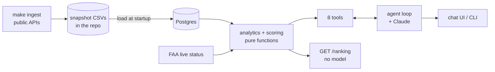

# Design: Airport Investment Intelligence Agent

- **Scoring:** a deterministic Expansion Pressure Score (0 to 100), the weighted sum of six national percentiles (growth, load factor, passengers per runway, demand gap, scale, peak ratio), computed in code from public BTS data.
- **Main tradeoff:** honest proxies and a committed data snapshot over false precision and live freshness: the agent says "not measured" instead of inventing long-haul shares, unmet demand or delays.
- **AI:** Claude picks tools and writes the explanation; code computes every number, ranking and explanation fact.

Related: [README](README.md) (run it) · [docs/DECISIONS.md](docs/DECISIONS.md) · [docs/EVALS.md](docs/EVALS.md) · [docs/DATA_SPIKE.md](docs/DATA_SPIKE.md)

## 1. Problem and scope

An investment firm wants to know where terminal or capacity expansion could pay off, judged by growth in flights and passenger demand. An analyst asks in chat, for example "which New England airports are strong expansion candidates", "compare LAX and Santa Ana congestion", "what share of Anchorage flights is long-haul", "what is the unmet demand at SFO and why", and follows up ("what if growth counts for more?").

**Covers:** US airports in the 50 states and DC. Traffic analysis covers the **228 peer airports** with at least 100,000 passengers in the last 12 months. Data is monthly, **latest April 2026**.

**Does not do:** profitability, physical terminal or gate capacity, passenger-experienced delay, carrier mix, true unmet demand, non-US airports, territories, voice, or any action beyond answering.

**Assumptions and uncertainty** (the agent states the ones that matter for each answer):

- **The score is relative.** Percentiles rank an airport against the 228 peers, so a high score means more pressure than other airports, not pressure in absolute terms. A weak market can top a ranking if its peers are weaker.
- **Data age.** The latest month is April 2026, about six months old; "last 12 months" means May 2025 to Apr 2026, compared with the 12 months before.
- **Passengers are counted by origin airport**, which approximates boardings.
- **Weights are judgment**, not fitted to expansion outcomes; the user can change them.
- **Runway count is a weak capacity proxy.** There is no terminal, gate or construction data, so the score measures demand pressure, not a proven capacity shortfall.
- **"Congestion" means utilization** (runway and seat use), not measured delay. There is no delay history; FAA status is a live snapshot.
- **Long-haul share and unmet demand are not measurable** from public data. The agent gives labelled proxies and signals, and any "why" is a hypothesis.
- **Cargo flights are included** in the source and cannot be separated; this affects departure, distance and international-share figures at cargo hubs.
- **Airports below 100,000 passengers** are not analysed; the agent says so.

## 2. Architecture

**One question:** `POST /chat` runs the loop: the model gets the conversation and tool schemas; requested tools are validated and run (concurrently when independent, with timeouts and one retry, errors returned as results); results go back to the model, up to six rounds; the answer is returned with a per-turn log. Last eval run: average 5.7 s per turn, p95 8.2 s.

`core/` (loop, tool registry, sessions, logging) knows nothing about airports; `domain/` holds everything airport-specific; adapters are wired in one place (`app/container.py`). The API is stateless: conversation state lives behind a `SessionStore` interface and is stored in Postgres, so a restart or a second replica keeps every conversation.

## 3. Data sources

| Source | Used for | How |
|---|---|---|
| **BTS T-100 summary by origin airport** (Socrata API) | passengers, seats, load factor, departures, flight distance, domestic vs international, monthly | snapshot (Jan 2019 to Apr 2026) |
| **OurAirports** (CSV) | state, coordinates, IATA code, runways with length and surface | snapshot |
| **FAA NAS status** (XML) | delay programs and closures right now | live call |

The snapshot (`domain/data/`, about 1.5 MB, committed) is rebuilt with `make ingest` and loaded into Postgres at startup. No external API sits on the request path, so answers are fast, survive a source outage and are reproducible; the cost is that data ages until the next ingest. Only the FAA feed is live.

**Rejected after testing** (see `docs/DATA_SPIKE.md`): *OpenSky* (anonymous access is the last ~6 hours; destination filled for 5% of flights); *BTS On-Time files* (bulk ZIPs, not an API, domestic passenger carriers only, while Anchorage's long-haul traffic is mostly international cargo); *ArcGIS T-100 table* (one row per airport per year, no routes).

**Cargo.** The T-100 summary includes all-cargo flights and cannot separate them (Anchorage's international departures average about 4 seats). Passengers, seats and load factor are unaffected; departure counts include cargo, which is right for runway pressure; average distance and international share describe all departures.

## 4. Scoring methodology

The **Expansion Pressure Score** is the weighted sum of six components. Each is an airport's **mid-rank percentile against the 228 peers nationally** (ties share the average rank), over the last 12 months versus the 12 before.

| Component | Definition | Weight | Why |
|---|---|---|---|
| Growth | passengers vs previous 12 months | 0.25 | demand is rising |
| Load factor | passengers / seats | 0.25 | planes are already full |
| Passengers per runway | passengers / commercial runways | 0.20 | rough capacity-pressure proxy |
| Demand gap | passenger growth minus seat growth | 0.15 | demand outpacing supply |
| Scale | passengers, last 12 months | 0.10 | more at stake at a big airport |
| Peak ratio | busiest month / average month | 0.05 | facilities are sized for the peak |

- **Why percentiles:** they put unlike units on one scale without arbitrary bounds (min-max lets one outlier squeeze everyone; z-scores assume a bell shape). They are national, so an airport's score is the same whatever region is asked.
- **Commercial runway:** open, paved, at least 5,000 ft. Santa Ana lists 2 runways, one a 2,886 ft strip, so it counts 1.
- **Peak ratio counts as positive** because terminals are sized for peak demand. The counter-argument (a terminal sized for a short peak sits idle) is real, so it has the smallest weight and can be set to 0. Reversing the sign changes 4 of the national top 20 and not the New England top two.
- **Exclusion rule:** an airport is scored only if all six components are computable; otherwise it is listed as *not scored* with reasons, never given a partial score. All 228 peers are scorable today, so this rule is covered by unit tests.
- **Re-weighting:** `{"growth": 0.6}` means exactly 0.6, the others share the rest proportionally. Percentiles are not recomputed.
- **Explanations are computed too:** each ranked airport carries `points` (weight × percentile per component, summing to the score), `main_driver`, plus `leaders_by_component` and `score_spread` for the airports shown.

## 5. The four example questions

| Question | How it is answered | Limit stated |
|---|---|---|
| **New England candidates** | `rank_airports`: Bangor 70.6, Portland 69.5, Burlington 67.0, Boston 63.7, New Haven 63.0, with points and driver per airport. Re-weighting is a follow-up call. | Demand pressure, not terminal capacity or profit; relative score; judgmental weights. |
| **LAX vs SNA congestion** | `compare_airports`: load factor 82.1% vs 80.4%, passengers per commercial runway per day 25,062 (4 runways) vs 15,316 (1), ratios computed in code; `get_live_status` for "now". | Utilization, not delay; no delay history. |
| **Long-haul share, ANC** | `get_distance_profile`: international share of departures (15.4%) and average stage length (1,900 mi) as **proxies**, never an exact percentage. | No route-level data. The share overcounts short international flights and undercounts long domestic ones; ANC's international flights are mostly cargo. |
| **Unmet demand, SFO** | `demand_pressure`: 1 of 12 months at or above 85% load factor (peak 89.4%, Jun 2025), passengers and seats both +3.4%, 96% and 95% of 2019. Reported as **signals**. | Unmet demand is not measured; the "why" is a hypothesis. |

## 6. Where AI is used, and where it is not

**The model (Claude Sonnet 5.5, configurable)** resolves what the user means ("LA" is LAX; "Portland" prompts a question), chooses and sequences tools, and writes the explanation, tables and caveats. **Code** computes every number, ranking, percentile, ratio, "highest" and "main driver", attaches the caveat texts, and decides what is unavailable. Tools take validated arguments only: no free-form SQL, parameterized queries. If the model is down, `GET /ranking` returns the same ranking; if tools fail, the agent says so and names no airports from memory (an eval case checks this).

Built with Claude Code; design decisions, data validation and review are mine.

## 7. Key tradeoffs

- **No agent framework.** The loop is one 187-line file I can read in full (iteration cap, parallel tools, timeouts, one retry). A framework would hide what an interviewer asks about.
- **No RAG.** The "knowledge" is a few definitions and caveats, kept in config and served by `get_methodology`. Retrieval would add a failure mode for no benefit; a document corpus would change this.
- **No MCP server yet.** Tools are in-process; wrapping them is a small step if other clients need them.
- **Snapshot data, not live calls:** speed and reproducibility versus freshness.
- **Proxies over false precision.** A confident long-haul percentage or "unmet demand" figure would be invented.
- **Judgmental weights.** Honest and adjustable, but not validated against expansion outcomes; that needs a labelled history I do not have.
- **Sessions in Postgres.** Already running, so no new service, and conversations survive restarts. Not built: Redis with a TTL for live state with Postgres for permanent transcripts; concurrent requests on one session are last-write-wins.
- **Reliability:** 30 s model and 10 s tool timeouts, each with one retry, then a graceful message.

## 8. Evaluation

20 cases: deterministic checks first (tool and arguments, required and forbidden text, ranking order against `GET /ranking`, a number audit that fails any number not in a tool result), then a three-vote model judge for groundedness. Eleven safety and honesty cases run three times and must pass every time.

| Run | What changed | Pass |
|---|---|---|
| 1 | first version | 12/18 (67%) |
| 2 | checker false positives fixed, length policy | 12/20 (60%) |
| 3 | audit formats, judge majority, score name | 17/20 (85%) |
| 4 | explanations computed in code | 15/20 (75%) |

**The noise lesson.** Run 2 fell because stricter checks exposed false positives, so a falling number was not a falling product. Run 4 fixed the two failures it targeted and different cases failed, within the noise I measured (the judge disagreed with itself on 3 of 19 answers). With one sample per non-safety case and a same-model judge, I treat a difference of a couple of cases as noise and stopped tuning. No failure is unsafe behavior. Methods, rubric and failures with fixes: [docs/EVALS.md](docs/EVALS.md).

## 9. Factors deliberately excluded

| Factor | Why excluded | How to add it |
|---|---|---|
| Origin-destination share, route demand | no route-level public API tested | T-100 segment/market files; new component and tool |
| Carrier concentration | no carrier-by-airport data | carrier-level T-100; a concentration metric |
| FAA grants and capital plans | not in the APIs used | ingest into a table; show as context |
| Municipal finance | different domain and sources | per-airport context field |
| Concessions revenue | no uniform public source | FAA airport financial reports (Form 5100-127) |
| Land, population growth | GIS and census domains | join by metro area, optional components |

Each is one more snapshot column, one config entry and one more percentile in `domain/scoring.py`; the loop does not change. None is added because I could not verify a source in time.

## 10. Next steps and production (documented, not built)

- **Data:** route-level and carrier data; monthly scheduled ingest with a diff report; delay history.
- **Serving:** Redis with a TTL for live sessions and Postgres for transcripts and audit; a per-session lock or version column (today the last write wins); a cap or summary for long histories; cleanup of old sessions; auth and rate limits on `/chat`; MCP server for the tools.
- **Voice latency:** stream output, smaller routing model, filler phrase on slow tools (data in memory and parallel tools already done).
- **Deployment:** containers, blue-green or canary, prompt+model+tools+config versioned as one release; rollback on eval pass rate, tool errors, p95 latency; `make eval` as CI gate.
- **Observability:** structured logs with correlation ids exist; OpenTelemetry traces, dashboards, cost per conversation, alerts do not.
- **Client integration:** swap the repository for the client's APIs, read-only first, with caching and prefetching.
- **Evals:** different judge model, more samples, real conversations as regression cases.
