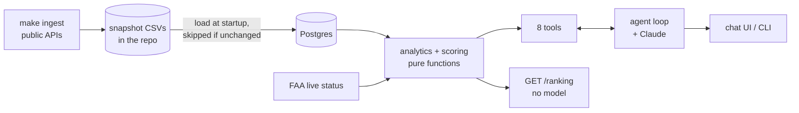

# Design: Airport Investment Intelligence Agent

An analyst chats with an agent to find US airports where terminal or capacity expansion looks most promising. The agent ranks and compares airports with a **deterministic score computed in code**. The model chooses which analysis to run and explains the result; it never calculates, ranks or recalls data. Built with Claude Code; design decisions, data validation and review are mine.

Related: [README](README.md) (run it) · [docs/DECISIONS.md](docs/DECISIONS.md) (every decision with alternatives) · [docs/EVALS.md](docs/EVALS.md) (method and results) · [docs/DATA_SPIKE.md](docs/DATA_SPIKE.md) (source checks).

## 1. Problem and scope

An investment firm wants to know where renovation or terminal expansion could pay off, judged by growth in flights and passenger demand. The agent answers questions such as "which New England airports are strong expansion candidates", "compare LAX and Santa Ana congestion", "what share of Anchorage flights are long-haul" and "what is the unmet demand at SFO and why", and handles follow-ups ("what if growth counts for more?").

- **Covers:** US airports in the 50 states and DC with an IATA code. Traffic analysis covers the **228 peer airports** with at least 100,000 passengers in the last 12 months. Data is **monthly, latest April 2026** (about six months old); the agent states this in every ranking.
- **Does not do:** measure profitability, physical terminal or gate capacity, passenger-experienced delay, carrier mix, or true unmet demand. It does not cover non-US airports, territories, voice, or any action beyond answering. Where a question needs one of these, it says so and offers the closest proxy, labelled as a proxy.

## 2. Architecture

**One question, step by step.** (1) The browser posts to `POST /chat` with a session id. (2) The API loads the conversation from the session store and runs the loop. (3) The loop sends the messages and tool schemas to the model. (4) If the model asks for tools, their arguments are validated and they run, concurrently when independent, with a timeout and one retry; errors come back as structured results, never as a crash. (5) Results are appended and the model is called again, up to six rounds. (6) The final text is returned with the turn's log line (tools, LLM and tool latency, tokens). Typical turn: 4 to 6 seconds (average 5.7 s, p95 8.2 s in the last eval run).

`core/` (loop, tool registry, sessions, logging) knows nothing about airports; everything airport-specific is in `domain/`. Adapters (Anthropic, Postgres, in-memory, FAA) are wired in one place, `app/container.py`. The API is stateless: state lives behind a `SessionStore` interface.

## 3. Data sources

| Source | Used for | How |
|---|---|---|
| **BTS T-100 summary by origin airport** (Socrata API, no key) | passengers, seats, load factor, departures, flight distance, domestic vs international departures, monthly | snapshot (peer airports, Jan 2019 to Apr 2026) |
| **OurAirports** (airports and runways CSV) | state, coordinates, IATA code, runways with length and surface | snapshot |
| **FAA NAS status** (XML, no key) | delay programs and closures right now | live call per question |

The snapshot (`domain/data/`, about 1.5 MB, committed) is rebuilt with `make ingest` and loaded into Postgres at startup. **Why a snapshot:** no external API sits on the request path, so answers are fast and survive a source being slow or down; and every number is reproducible from the repository. The cost is that data ages until someone refreshes it. Only the FAA feed is called live, because a snapshot of "now" is meaningless.

**Rejected after testing** (details in `docs/DATA_SPIKE.md`): *OpenSky* (anonymous access returns the last ~6 hours only, and destination airport was filled for 5% of flights); *BTS On-Time files* (bulk monthly ZIPs of 27 to 33 MB, not an API, domestic passenger carriers only, while Anchorage's long-haul traffic is mostly international cargo); *the ArcGIS T-100 table* (one row per airport per year, no destination or distance, so not route-level).

**Cargo.** The T-100 summary includes all-cargo flights and cannot separate them. Anchorage's international departures average about 4 seats each, which gives it away. Passengers, seats and load factor are unaffected; departure counts include cargo (correct for runway pressure); average flight distance and international share describe all departures. The agent states this for cargo-heavy airports.

## 4. Scoring methodology

The **Expansion Pressure Score (0 to 100)** is the weighted sum of six components. Each component is an airport's **mid-rank percentile against the 228 peers nationally** (ties share the average rank). All components are measured over the last 12 months (May 2025 to Apr 2026) against the 12 months before.

| Component | Definition | Weight | Why |
|---|---|---|---|
| Growth | passengers vs the previous 12 months | 0.25 | demand is rising |
| Load factor | passengers / seats | 0.25 | planes are already full |
| Passengers per runway | passengers / commercial runways | 0.20 | rough capacity-pressure proxy |
| Demand gap | passenger growth minus seat growth, in points | 0.15 | demand outpacing what airlines supply |
| Scale | passengers in the last 12 months | 0.10 | more is at stake at a big airport |
| Peak ratio | busiest month / average month | 0.05 | facilities are sized for the peak |

- **Why percentiles:** they put unlike units on one scale without choosing arbitrary bounds. Min-max lets one outlier squeeze everyone; z-scores assume a bell shape. Because they are always national, an airport's score is the same whatever region you ask in (a regional ranking orders by the national score; a test checks this).
- **Commercial runway:** open, paved, at least 5,000 ft. Short strips would otherwise make airports look less busy per runway: Santa Ana lists 2 runways, one of them a 2,886 ft strip, so it counts 1.
- **Peak ratio counts as positive, weight 0.05.** Terminals are sized for peak demand, so a peaky airport feels the limit. The counter-argument (a terminal sized for a short peak sits idle and returns less) is real, so the weight is the smallest and can be set to 0. Reversing the sign changes 4 of the national top 20 and not the New England top two.
- **Exclusion rule:** an airport is scored only if all six components are computable (no missing month in either window, seats and runway data present). Otherwise it is listed as *not scored* with reasons, never given a partial score. All 228 peers are currently scorable, so this rule is covered by unit tests, not real airports.
- **Weights are judgment, not a fitted model.** They live in `domain/config.yaml` and a user can override them in chat (`{"growth": 0.6}` means exactly 0.6; the others share the rest proportionally). Percentiles are not recomputed, only re-weighted, so the effect is easy to explain.
- **Explanations are computed too.** Each ranked airport carries `points` (weight × percentile per component, summing to the score), its `main_driver`, the `leaders_by_component` among the airports shown, and the score spread. The model quotes these rather than comparing raw numbers (see section 8 for why).

## 5. The four example questions

| Question | How it is answered | Limit stated |
|---|---|---|
| **New England expansion candidates** | `rank_airports(region="New England")`: Bangor 70.6, Portland 69.5, Burlington 67.0, Boston 63.7, New Haven (HVN) 63.0 (current snapshot; the table shows each airport's `points` and driver). Re-weighting is a follow-up call. | Score is demand pressure, not terminal capacity or profit; weights are judgmental. |
| **LAX vs SNA congestion** | `compare_airports`: load factor (82.1% vs 80.4%), passengers per commercial runway per day (25,062 on 4 runways vs 15,316 on 1), ratios and differences computed in code, plus `get_live_status` if asked about now. | "Congestion" means runway and seat utilization. There is no delay history; the FAA feed is a snapshot and absence means no reported delay. |
| **Long-haul share out of ANC** | `get_distance_profile`: international share of departures (15.4%) and average stage length (1,900 mi) as **proxies**. The agent does *not* give an exact long-haul percentage. | Route-level distances are not in any public API tested. The international share overcounts short international flights (Canada) and undercounts long domestic ones; ANC's international flights are mostly cargo. |
| **Unmet demand at SFO and why** | `demand_pressure`: months with load factor at or above 85% (1 of 12, peak 89.4% in Jun 2025), passengers vs seats growth (3.4% vs 3.4%), recovery vs 2019 (96% passengers, 95% seats). Reported as **signals**; any "why" is labelled a hypothesis. | Unmet demand is not measured by any public data (no fares, waitlists or spill). |

(Figures above are from the committed snapshot and reproduce from `GET /ranking` and the tools; I computed them without the model.)

## 6. Where AI is used, and where it is not

**The model (Claude Sonnet 5.5, configurable)** does three things: resolves what the user means ("LA" → LAX, "Portland" → asks which), chooses and sequences tools (parallel when independent), and writes the explanation, tables and caveats. The system prompt tells it to state the as-of date, say what a metric is, and refuse to name datasets it cannot check.

**Code** computes every number, ranking, percentile, ratio, difference, "highest" and "main driver", attaches the caveat texts, and decides what is unavailable. Tools take validated arguments only; there is no free-form SQL, and queries are parameterized. If the model is down, `GET /ranking` still returns the same ranking. If tools fail, the agent says it could not retrieve data and names no airports from memory (an eval case checks this).

## 7. Key tradeoffs

- **No agent framework.** The loop is one 187-line file I can read in full (iteration cap, parallel tools, timeouts, one retry). A framework would hide exactly what an interviewer asks about.
- **No RAG.** The "knowledge" is a handful of definitions and caveats, so they sit in config and are served by `get_methodology`. Retrieval would add a failure mode for no benefit. A document corpus (airport master plans, FAA reports) would change this.
- **No MCP server, for now.** Tools are in-process. Wrapping them as an MCP server is a small step if other clients need them (section 10).
- **Snapshot data, not live calls** (section 3): speed and reproducibility versus freshness.
- **Proxies over false precision.** A confident long-haul percentage or "unmet demand" figure would be invented. Labelled proxies are less impressive and more honest.
- **Judgmental weights.** Honest and adjustable, but not validated against actual expansion outcomes; that needs a labelled history of expansions, which I do not have.
- **In-memory sessions.** Fine for one process; two replicas need the Redis store.
- **Reliability:** 30 s LLM timeout and 10 s tool timeout, each with one retry, then a graceful message.

## 8. Evaluation

The 20 cases (`domain/eval_cases.yaml`) cover the four assignment questions, data limits, names, live status, outage, injection and off-topic. Checks are deterministic first: tool called, argument values, required and forbidden phrases, the New England top five in the same order as `GET /ranking`, and a **number audit** that fails any number not found in a tool result. A model judge (majority of three) checks groundedness against the tool results with a fixed rubric. Eleven safety and honesty cases run three times and must pass every time. Unit tests cover the scoring math with fixed numbers.

| Run | What changed | Pass |
|---|---|---|
| 1 | first version | 12/18 (67%) |
| 2 | fixed checker false positives, length policy | 12/20 (60%) |
| 3 | audit formats, judge majority, score name | 17/20 (85%) |
| 4 | explanations computed in code (points, leaders, spread) | 15/20 (75%) |

**The lessons.** Run 2 went *down* because stricter checks exposed false positives, so a falling number was not a falling product. Run 4 fixed two targeted failures (a wrong superlative and a model-computed difference) and a different set of cases failed, within the noise I measured (the same judge disagreed with itself on 3 of 19 answers). With one sample per non-safety case and a same-model judge, I treat differences of a couple of cases as noise. **Known failures:** five cases, none unsafe. Two safety cases sit at 2 of 3 because of an audit false positive (the model described its own abilities, "compare 2 to 5 airports") and a judge that cannot see the system prompt. Full list with causes and fixes: [docs/EVALS.md](docs/EVALS.md). The rule I held: a check changes only to fix a real false positive, with tests of answers that must still fail.

## 9. Factors deliberately excluded

| Factor | Why excluded | How to add it |
|---|---|---|
| Origin and destination (O&D) share, route-level demand | no route-level data in tested public APIs | route-level T-100 segment/market files; new component and a `get_routes` tool |
| Carrier concentration | no carrier-by-airport data | carrier-level T-100 by airport; a concentration (HHI) metric |
| FAA grants (AIP) and capital plans | not in the APIs used; mixed formats | ingest FAA grant data into a table; show as context, not score |
| Municipal finance, bond ratings | outside aviation data; needs different sources | a context field per airport, reviewed by an analyst |
| Concessions and non-aeronautical revenue | not public in a uniform form | FAA airport financial reports (Form 5100-127) |
| Land availability, local population growth | different domains (GIS, census) | census and GIS joins by metro area, as optional components |

Each would be one more column in the snapshot, one more entry in `config.yaml` (definition, weight, caveat) and one more percentile in `domain/scoring.py`; the loop and tools do not change. None is added because I could not verify a source and "profitable" would still not be measured.

## 10. Next steps, and what production would need (documented, not built)

- **Data:** route-level and carrier data (above); scheduled ingest (monthly, with a diff report and an as-of alert); delay history to measure congestion directly.
- **Serving:** Redis `SessionStore` with a per-session lock (today two concurrent requests on one session can interleave); an MCP server exposing the same tools; rate limits and authentication on `/chat` (today the session id is the only handle).
- **Latency, for voice:** stream the model output, keep the data in memory (already a snapshot), parallel tools (already built), smaller model for routing, filler phrase if a tool is slow.
- **Deployment:** containers, blue-green or canary with prompt, model, tools and config versioned as one release; rollback on eval pass rate, tool error rate or p95 latency; the CI gate would be `make eval` plus the safety cases at 3 of 3.
- **Observability:** structured logs with correlation and session ids and a per-turn summary exist; OpenTelemetry traces (a span per model and tool call), dashboards, cost per conversation and alerts do not.
- **Integration at a client:** the repository interface is the seam, so Postgres can be replaced by the client's APIs, read-only first; caching and prefetching then matter more than query tuning.
- **Evals:** a different model as judge, more samples per case, real conversations turned into regression cases.
