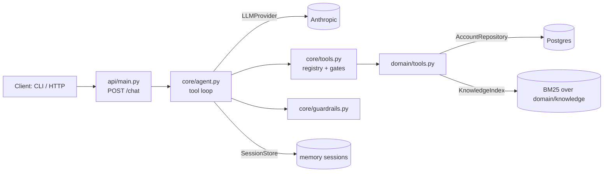

# Design

## The client's problem (placeholder domain)
Example Investments' call center is overloaded with routine questions: "what's my balance", "where is my withdrawal", "what's the early withdrawal fee". Each call costs a human agent's time, while the cases that need a human (fraud, complaints, licensed advice) wait in the same queue. The agent handles the routine, verified, read-mostly requests and hands the rest to a person with a structured summary.

## What the agent does
- Verifies identity (customer ID + last 4 phone digits) before showing any personal data.
- Reads account data: balance and holdings, recent transactions, withdrawal status.
- Answers general questions (fees, rules, products) from a small knowledge base, grounded in retrieved text.
- Opens a withdrawal request, only after explicit confirmation.
- Escalates to a human with a handoff summary.

## What it explicitly does not do
- Personalised investment advice (needs a licence in Israel). It refuses and offers a licensed advisor.
- Anything beyond one write action (no transfers, no profile changes).
- Real authentication. Customer ID + 4 phone digits is a mocked, weak factor for the demo (see PRODUCTION.md).
- Voice, streaming, multi-language tuning: not built (future work).

## Architecture

`core/` only knows the interfaces in `core/interfaces.py`. Adapters in `adapters/` implement them and `app/container.py` wires everything. Everything domain-specific is in `domain/`.

## One turn
1. `POST /chat` gives a session ID and a message to `Agent.run_turn`.
2. The session is loaded. If it was already escalated, a fixed hand-over reply is returned (no LLM call).
3. Loop (max 6 iterations): call the LLM with the system prompt, history and tool schemas. If it asks for tools, the registry runs them concurrently (`asyncio.gather`) and the results go back to the model. Otherwise the text is the answer.
4. Each tool call passes the gates in `ToolRegistry`: known tool, valid arguments, **identity** (code), **write confirmation** (code), then runs with timeout and one retry. Failures become structured error results.
5. The reply passes the output guardrail (advice check). On a violation it is replaced with a refusal.
6. The turn is saved and a JSON log line is written (tools, latencies, tokens, flags; never message text).

## State per session
`verified_customer_id`, `failed_verifications`, `pending_action` (a proposed write with its idempotency key), `handoff`, `turn`, and the message history (including tool calls and results).
